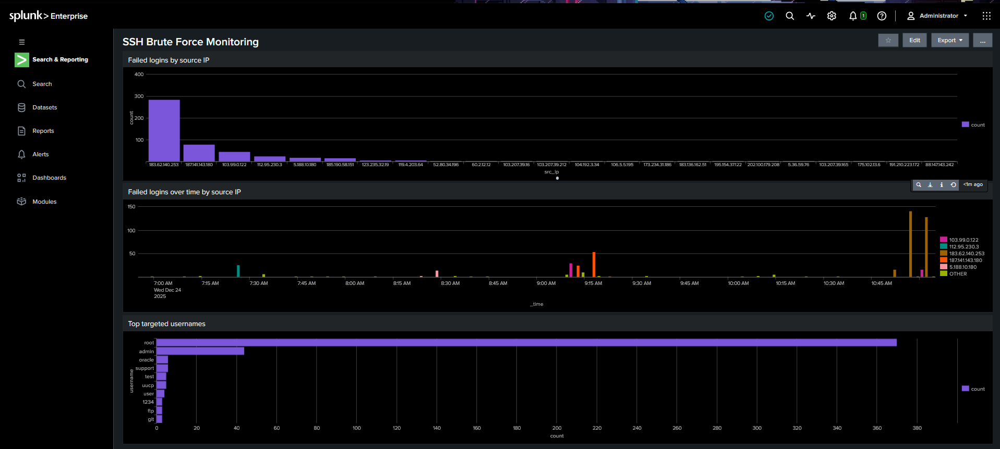
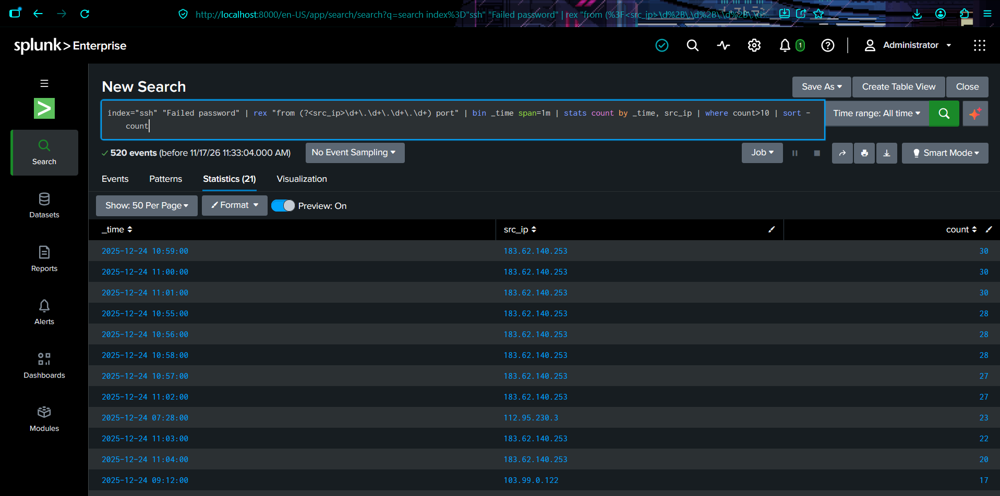
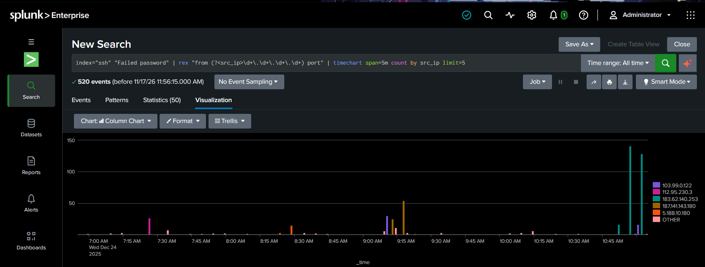
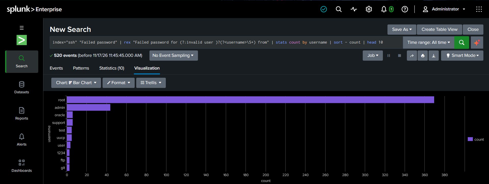
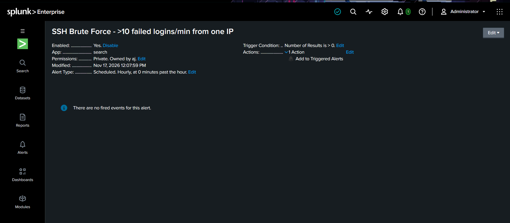
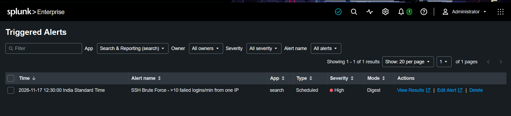
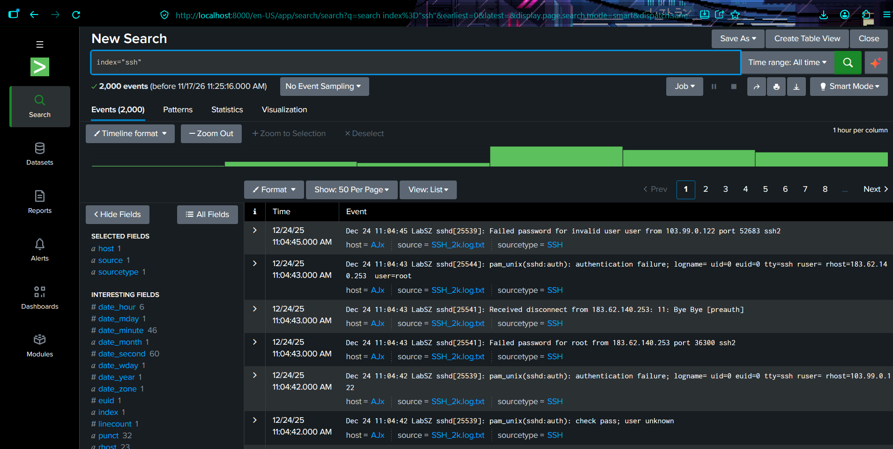
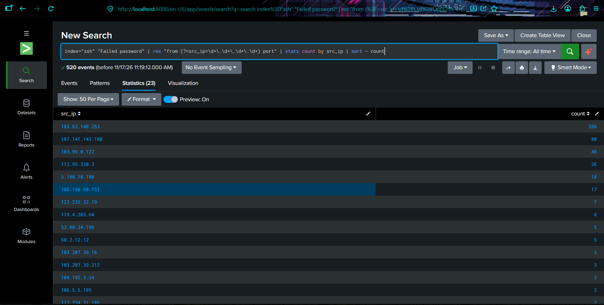

# SSH Brute-Force Detection and Analysis in Splunk

Analysis of a public SSH authentication log in Splunk Enterprise using SPL and regex field extraction. The project identifies automated brute-force activity, builds a detection alert and a monitoring dashboard, and maps the findings to MITRE ATT&CK.

> **Data source:** [Loghub](https://github.com/logpai/loghub) public SSH sample (`SSH_2k.log`, 2,000 lines, host `LabSZ`). This is a public research dataset, not live or production data, and I did not generate it. The log has no year in its timestamps, so Splunk infers it. Dates below are shown as "Dec 24".

## Summary of findings

| Metric | Result |
|---|---|
| Events analysed | 2,000 |
| Failed password events | 520 |
| Unique source IPs with failures | 23 |
| Top attacker | `183.62.140.253` with 286 failures (55% of all failures) |
| Top 3 IPs | 412 of 520 failures (79%) |
| One-minute windows with more than 10 failures | 21, from 5 source IPs |
| Most targeted account | `root`, 370 attempts (71%) |
| Distinct usernames attempted | 62 |

**Key observation:** all 286 failures from `183.62.140.253` occurred in one continuous 11-minute burst (about 10:54 to 11:04), peaking at 30 attempts per minute. That is roughly one attempt every two seconds, which indicates automated tooling. All of its attempts targeted `root`, and none of them succeeded.



*Dashboard: failed logins by source IP, failed logins over time by IP, and top targeted usernames.*

## Attack timeline

| Source IP | Windows over 10/min | Failures in those windows | Pattern |
|---|---|---|---|
| `183.62.140.253` | 11 | 286 | 11 consecutive minutes, peak 30/min, root only |
| `187.141.143.180` | 5 | 56 | Sustained burst around 09:12 to 09:20 |
| `103.99.0.122` | 3 | 41 | Repeated bursts starting around 09:11 |
| `112.95.230.3` | 1 | 23 | Single burst at 07:28, mostly root |
| `5.188.10.180` | 1 | 11 | Brief burst |

Attack activity is concentrated in a few short bursts from different IPs rather than a steady flow.



*Search result: the 21 one-minute windows with more than 10 failed logins from one IP.*



*Failed logins over time (5-minute buckets) by source IP. The two tall columns at the right are the 183.62.140.253 burst.*

## Username analysis

`root` and `admin` account for about 80% of all failed attempts. The rest is a long tail of default and service names (`oracle`, `support`, `test`, `uucp`, `user`, `ftp`, `git`, `guest`, `matlab`, `1234`). Sixty-two distinct usernames were tried, which is consistent with dictionary-style guessing by automated tools rather than a targeted attack on a known account.



*Top 10 targeted usernames. `root` dominates with 370 attempts.*

## Verdicts

| Indicator | Verdict | Reasoning |
|---|---|---|
| `183.62.140.253` | True positive: brute force, blocked | 286 failed root logins in 11 minutes, no success |
| `187.141.143.180` | True positive: brute force, blocked | Sustained bursts, no success |
| `103.99.0.122` | True positive: brute force, blocked | Repeated bursts, no success |
| `112.95.230.3` | True positive: brute force, blocked | Single short burst, mostly root |
| Successful login: `fztu` from `119.137.62.142` (about 09:32, session of about 13 minutes) | No indicators of compromise in this dataset | No failed attempts from that IP in the sample. In a real environment I would confirm it with the account owner |

## MITRE ATT&CK mapping

- **T1110 / T1110.001, Brute Force: Password Guessing.** Repeated failed logins against `root` and many default usernames.
- **T1078, Valid Accounts.** Referenced only as a check for the single successful login, not as a finding.

## Detection

**Alert: "SSH Brute Force - >10 failed logins/min from one IP"**

- Logic: more than 10 failed SSH password attempts from one source IP within 1 minute.
- Schedule: hourly. Trigger: number of results > 0. Action: add to Triggered Alerts.
- Result: the alert fired (High severity) and matched the 21 windows above.

**Production note:** this demo runs on the whole dataset ("All time") because the data is static and old. In a live environment it would run on a rolling window (for example the last 15 minutes) every few minutes, and the action would be an email, a ticket, or a SOAR step to block the IP.



*Alert configuration: scheduled hourly, triggers when the number of results is greater than 0, action: Add to Triggered Alerts.*



*The alert fired with High severity.*

## Recommendations

1. Disable password authentication and use SSH keys only.
2. Set `PermitRootLogin no`.
3. Add rate limiting or automatic banning (for example fail2ban).
4. Restrict SSH exposure to a VPN or an allowlist of IPs.
5. Alert on any successful login that follows multiple failures from the same IP.
6. Enrich the source IPs with threat-intelligence and geolocation data.

## SPL queries

```spl
# Failed logins by source IP
index="ssh" "Failed password"
| rex "from (?<src_ip>\d+\.\d+\.\d+\.\d+) port"
| stats count by src_ip
| sort - count

# Brute-force bursts (more than 10 failures per minute from one IP)
index="ssh" "Failed password"
| rex "from (?<src_ip>\d+\.\d+\.\d+\.\d+) port"
| bin _time span=1m
| stats count by _time, src_ip
| where count>10
| sort - count

# Top targeted usernames
index="ssh" "Failed password"
| rex "Failed password for (?:invalid user )?(?<username>\S+) from"
| stats count by username
| sort - count
| head 10

# Attack timeline by source IP
index="ssh" "Failed password"
| rex "from (?<src_ip>\d+\.\d+\.\d+\.\d+) port"
| timechart span=5m count by src_ip limit=5

# Successful logins (to check for success after failures)
index="ssh" "Accepted password"
| rex "for (?<username>\S+) from (?<src_ip>\S+)"
| table _time username src_ip
```

## Setup and evidence



*All 2,000 events ingested into `index="ssh"` (source `SSH_2k.log.txt`, sourcetype `SSH`).*



*520 failed password events across 23 source IPs, led by 183.62.140.253 with 286.*

All screenshots are in the [`screenshots/`](screenshots/) folder.

## How to reproduce

1. Download `SSH_2k.log` from [Loghub](https://github.com/logpai/loghub).
2. In Splunk, create an index called `ssh` and upload the file (sourcetype `SSH`).
3. Set the time range to **All time** and run the searches in [`queries.spl`](queries.spl).
4. Save the burst search as a scheduled alert and the three chart searches as dashboard panels.

## Limitations

- Static public dataset: no live traffic, no real response actions.
- Timestamps have no year, so the year shown in Splunk is inferred.
- Source IPs were not enriched with reputation or geolocation data.
- The alert uses "All time" to demonstrate the logic, as explained above.

## Tools

Splunk Enterprise, SPL, regex field extraction (`rex`), MITRE ATT&CK.
